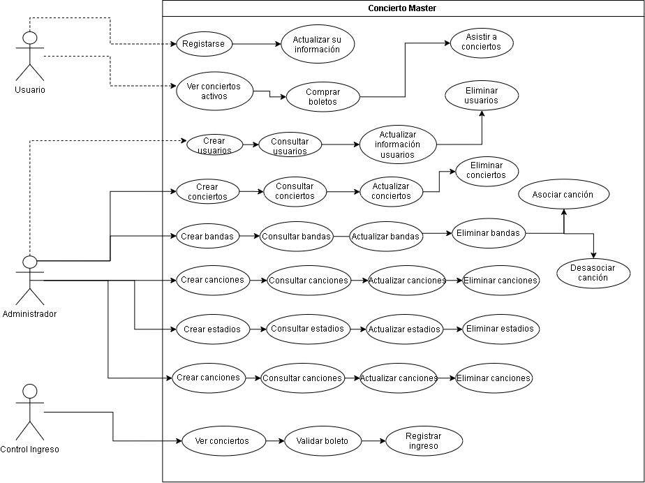
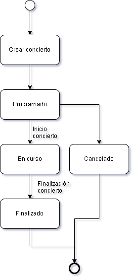
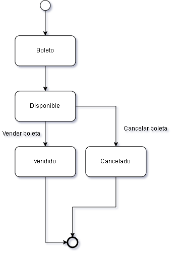
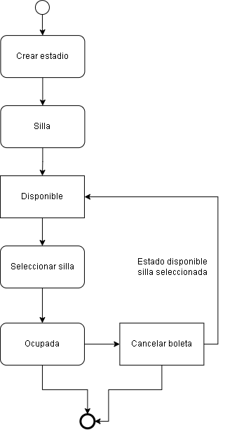
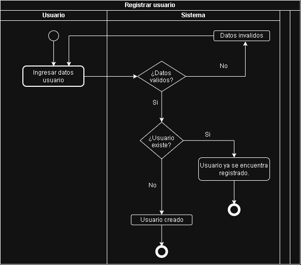
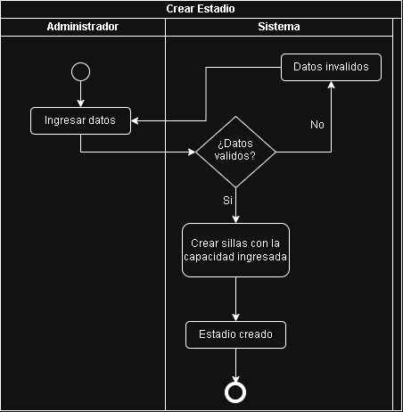
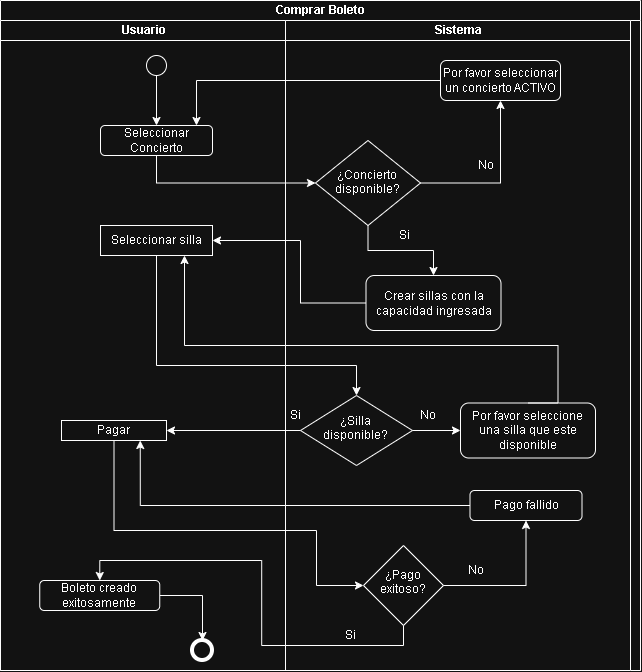
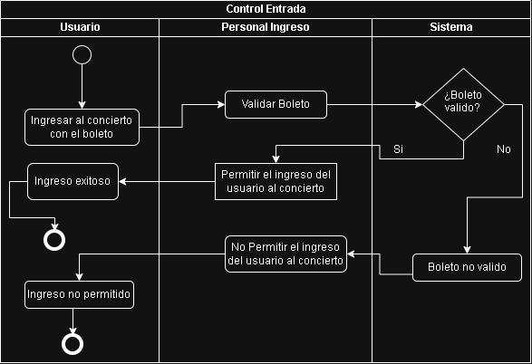
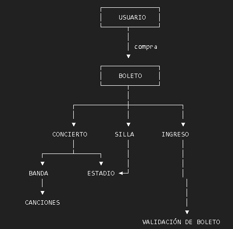

# Especificación de Requisitos del Sistema (ERS)

# CONCIERTO MASTER

## Documento de Especificación de Requisitos del Sistema

Versión: 1.0

Autor: Caterine Salinas Bolanos

Fecha: 17/11/2026

# Tabla de contenido

- Introducción
- 1.1 Descripción del proyecto
- 1.2 Problema que resuelve
- 1.3 Objetivo general
- 1.4 Objetivos específicos
- 1.5 Alcance
- 1.6 Beneficios
- Actores del sistema
- Requisitos funcionales
- Reglas del negocio
- Casos de uso
- Requisitos no funcionales
- Restricciones del proyecto
- Glosario

# 1. Introducción

## 1.1 Descripción del proyecto

Concierto Master es un sistema de gestión cuyo propósito es administrar y controlar el ciclo completo relacionado con la organización de conciertos masivos. El sistema permite gestionar la información de los usuarios registrados, los conciertos disponibles, la venta de boletos, la asignación de sillas y el control de ingreso de los asistentes.

Mediante la integración de estos procesos, el sistema centraliza la información necesaria para garantizar una administración organizada, segura y trazable durante todas las etapas del evento.

## 1.2 Problema que resuelve

La organización de conciertos involucra diferentes procesos que, si se realizan de manera manual o mediante herramientas independientes, pueden generar errores en la administración de usuarios, asignación de sillas, venta de boletos y control de acceso.

Concierto Master busca centralizar estos procesos en un único sistema, permitiendo una mayor trazabilidad de la información, optimizando la organización de los eventos y facilitando el seguimiento de cada una de las operaciones realizadas.

## 1.3 Objetivo general

Desarrollar un sistema de gestión de conciertos que permita administrar usuarios, conciertos, boletos y el control de ingreso de los asistentes, con el fin de optimizar la organización, centralizar la información y garantizar la trazabilidad de los procesos relacionados con la realización de conciertos masivos.

## 1.4 Objetivos específicos

- Gestionar los usuarios registrados en el sistema.
- Gestionar la información de los conciertos.
- Gestionar las bandas participantes y sus canciones.
- Gestionar los estadios y las sillas disponibles.
- Permitir la compra y cancelación de boletos.
- Controlar el ingreso de los asistentes.
- Mantener actualizada la disponibilidad de las sillas.
- Garantizar la integridad y consistencia de la información.

## 1.5 Alcance

Concierto Master permitirá administrar el proceso completo de gestión de conciertos desde el registro de los usuarios hasta el control de ingreso al evento.

El sistema contemplará la administración de usuarios, conciertos, bandas, canciones, estadios, sillas, boletos y el proceso de validación del ingreso de los asistentes.

No forma parte del alcance del proyecto la gestión de pagos electrónicos, autenticación mediante cuentas externas, generación de facturas electrónicas ni la integración con servicios de terceros.

## 1.6 Beneficios

La implementación del sistema permitirá:

- Centralizar la información del evento.
- Reducir errores durante la venta de boletos.
- Optimizar el control de ingreso.
- Mantener la disponibilidad real de las sillas.
- Mejorar la organización de los conciertos.
- Facilitar el seguimiento de todas las operaciones realizadas dentro del sistema.

# 2. Actores del sistema

## Usuario

Persona registrada en el sistema que puede actualizar su información personal, consultar los conciertos disponibles, comprar y cancelar boletos, además de asistir al concierto mediante un boleto válido.

## Administrador

Responsable de gestionar la información del sistema, incluyendo usuarios, bandas, canciones, estadios y conciertos.

## Personal de ingreso

Responsable de validar los boletos y registrar el ingreso de los asistentes al concierto.

# 3. Matriz de permisos

| Funcionalidad | Usuario | Administrador | Personal de ingreso |
|---|---|---|---|
| Registrarse en el sistema | ✅ | ✅ (puede registrar a otra persona) | ❌ |
| Actualizar su información | ✅ | ✅ | ❌ |
| Eliminar usuario | ❌ | ✅ | ❌ |
| Consultar usuarios | ❌ | ✅ | ❌ |
| Registrar banda | ❌ | ✅ | ❌ |
| Actualizar banda | ❌ | ✅ | ❌ |
| Eliminar banda | ❌ | ✅ | ❌ |
| Registrar canciones | ❌ | ✅ | ❌ |
| Gestionar estadios | ❌ | ✅ | ❌ |
| Gestionar conciertos | ❌ | ✅ | ❌ |
| Consultar conciertos | ✅ | ✅ | ✅ |
| Comprar boleto | ✅ | ❌ | ❌ |
| Cancelar boleto | ✅ | ❌ | ❌ |
| Consultar sus boletos | ✅ | ❌ | ❌ |
| Validar ingreso | ❌ | ❌ | ✅ |

# 4. Requisitos funcionales

## RF-01. Gestión de Usuarios

El sistema deberá permitir:

- RF-01. Registrar usuarios.
- RF-02. Consultar un usuario.
- RF-03. Consultar todos los usuarios registrados.
- RF-04. Actualizar la información de un usuario.
- RF-05. Eliminar un usuario.

## RF-02. Gestión de Bandas

El sistema deberá permitir:

- RF-06. Registrar bandas.
- RF-07. Consultar una banda.
- RF-08. Consultar todas las bandas.
- RF-09. Actualizar la información de una banda.
- RF-10. Eliminar una banda.

## RF-03. Gestión de Canciones

El sistema deberá permitir:

- RF-11. Registrar canciones.
- RF-12. Consultar una canción.
- RF-13. Consultar todas las canciones.
- RF-14. Actualizar la información de una canción.
- RF-15. Eliminar una canción.
- RF-16. Asociar canciones a una banda.
- RF-17. Desasociar canciones de una banda.

## RF-04. Gestión de Estadios

El sistema deberá permitir:

- RF-18. Registrar estadios.
- RF-19. Consultar un estadio.
- RF-20. Consultar todos los estadios.
- RF-21. Actualizar la información del estadio.
- RF-22. Eliminar un estadio.

## RF-05. Gestión de Conciertos

El sistema deberá permitir:

- RF-23. Registrar conciertos.
- RF-24. Consultar un concierto.
- RF-25. Consultar todos los conciertos.
- RF-26. Actualizar la información de un concierto.
- RF-27. Eliminar un concierto.

## RF-06. Gestión de Boletos

El sistema deberá permitir:

- RF-28. Comprar un boleto.
- RF-29. Consultar un boleto.
- RF-30. Consultar todos los boletos.
- RF-31. Cancelar un boleto.
- RF-32. Consultar los boletos asociados al usuario.

## RF-07. Control de Ingreso

El sistema deberá permitir:

- RF-33. Registrar el ingreso de un asistente.
- RF-34. Consultar los ingresos registrados.

# 5. Reglas del negocio

## Gestión de Usuarios

RN-01. Cada usuario deberá identificarse mediante un número de identificación único dentro del sistema.

RN-01A. Al registrar un usuario, el sistema deberá exigir que la edad sea mayor o igual a 18 años.

RN-02. No podrán existir dos usuarios registrados con el mismo número de identificación.

RN-03. Si un usuario solicita actualizar su número de identificación, el sistema deberá verificar previamente que dicho número no pertenezca a otro usuario registrado.

RN-04. Un usuario no podrá eliminarse mientras tenga al menos un boleto activo asociado.

## Gestión de Bandas

RN-05. Una banda podrá existir sin tener canciones asociadas.

RN-06. Una banda no podrá eliminarse mientras esté asociada a uno o más conciertos.

## Gestión de Canciones

RN-07. Una canción podrá existir sin estar asociada a una banda.

RN-08. Una misma canción puede estar asociada a más de una banda.

RN-08A. No podrán registrarse dos canciones equivalentes dentro de una misma banda. Se consideran equivalentes dos canciones con el mismo nombre, sin distinción de mayúsculas, el mismo año y el mismo género musical.

La equivalencia es una comparación de contenido, no de identidad: dos canciones equivalentes siguen siendo registros distintos, identificados por su `id`. El criterio solo decide si una canción puede incorporarse al repertorio de una banda.

RN-09. Una canción no podrá eliminarse mientras pertenezca a una banda asociada a un concierto.

## Gestión de Estadios

RN-10. Al registrar un estadio, el sistema deberá generar automáticamente las sillas de acuerdo con la capacidad indicada.

RN-10A. Al registrar o modificar un estadio, el sistema deberá exigir que la capacidad sea mayor o igual a 20 y múltiplo de 10. Si no se cumple, el sistema rechazará la operación.

RN-10B. Al generar las sillas, el estadio deberá asignar a cada una una categoría: VIP o GENERAL.

RN-11. La capacidad del estadio únicamente podrá modificarse cuando todas las sillas se encuentren disponibles.

RN-12. Si existe al menos una silla ocupada, el sistema deberá rechazar la modificación de la capacidad.

RN-13. Un estadio no podrá eliminarse mientras tenga conciertos asociados.

## Gestión de Conciertos

RN-14. Todo concierto deberá estar asociado a una banda y a un estadio previamente registrados.

RN-14A. El estado del concierto será actualizado automáticamente por el sistema de acuerdo con la fecha y hora del evento.

RN-14B. Un concierto permanecerá en estado PROGRAMADO desde su creación hasta la fecha y hora de inicio del evento.

RN-14C. Cuando la fecha y hora del concierto sean alcanzadas, el sistema cambiará automáticamente su estado a EN_CURSO.

RN-14D. Una vez finalizada la fecha y hora del evento, el sistema cambiará automáticamente el estado del concierto a FINALIZADO.

RN-14E. Para registrar un concierto, la banda seleccionada deberá tener al menos una canción asociada. Si la banda no tiene canciones registradas, el sistema no permitirá la creación del concierto.

RN-14F. Al registrar o modificar un concierto, el sistema no permitirá ingresar un precio base general inferior a 30.000 COP.

RN-14G. Al registrar o modificar un concierto, el sistema no permitirá ingresar un precio base VIP inferior a 60.000 COP.

RN-15. Un concierto únicamente podrá eliminarse cuando no existan boletos activos asociados.

RN-16. La información de un concierto únicamente podrá modificarse cuando no existan boletos activos asociados a dicho concierto.

RN-17. Un concierto únicamente podrá cambiar de estadio cuando no existan boletos activos asociados.

RN-18. Solo podrán venderse boletos para conciertos cuyo estado sea PROGRAMADO.

RN-19. Solo podrá registrarse el ingreso de asistentes cuando el concierto esté en estado EN_CURSO.

RN-20. Un concierto FINALIZADO no podrá modificarse.

RN-21. Un concierto podrá ser cancelado únicamente cuando no existan boletos activos asociados.

RN-22. Un concierto CANCELADO no permitirá la venta de boletos ni el ingreso de asistentes.

## Tabla de estados Concierto

| Estado | Cómo llega al estado | ¿Venta? | ¿Ingreso? | ¿Modificación? |
|---|---|---|---|---|
| PROGRAMADO | Creación del concierto | Sí | No | Sí, si no hay boletos activos |
| EN_CURSO | Automáticamente por fecha/hora | No | Sí | No |
| FINALIZADO | Automáticamente por fecha/hora | No | No | No |
| CANCELADO | Cancelación autorizada | No | No | No |

## Gestión de Boletos

El sistema maneja **dos categorías de boleto: GENERAL y VIP**. Cada categoría tiene su propio
precio base, definido por el concierto, con un valor mínimo que el sistema no permite ingresar
por debajo:

| Categoría | Precio base | Valor mínimo |
|---|---|---|
| GENERAL | Definido por el concierto | 30.000 COP |
| VIP | Definido por el concierto | 60.000 COP |

El valor del boleto es el precio base de su categoría al momento de la compra y permanece fijo.

RN-23. Un boleto únicamente podrá comprarse para un concierto cuyo estado sea PROGRAMADO.

RN-23A. El sistema clasifica los boletos en dos categorías, GENERAL y VIP, y aplica a cada una el precio base definido por el concierto para esa categoría.

RN-23B. El valor del boleto será el precio base de su categoría al momento de la compra y permanecerá fijo.

RN-24. El usuario deberá seleccionar una silla disponible antes de completar la compra.

RN-25. Una silla únicamente podrá estar asociada a un boleto activo.

RN-26. Al comprar un boleto, la silla cambiará automáticamente al estado Ocupada.

RN-27. Al cancelar un boleto, este cambiará al estado Cancelado y la silla volverá al estado Disponible.

## Control de Ingreso

RN-28. Solo podrá ingresar un usuario que posea un boleto activo.

RN-29. Un boleto únicamente podrá utilizarse una vez para ingresar al concierto.

RN-30. Si el boleto se encuentra cancelado, el sistema rechazará el ingreso.

RN-31. Si el boleto ya fue utilizado para ingresar, el sistema rechazará un nuevo intento de ingreso.

# 6. Modelado funcional

## 6.1. Diagrama de Casos de Uso

¿Qué puede hacer cada actor dentro del sistema?

## 6.2. Diagrama de Estados

¿Cómo cambia de estado un objeto?

- Concierto

- Boleto

- Silla

## 6.3. Diagrama de actividades

¿Cómo se ejecuta paso a paso una funcionalidad específica del sistema?

Registrar usuario

Crear Estadio

Comprar Boleto

Control Entrada

# 7. Casos de uso

## 7.1 Gestión de Usuarios

### CU-01. Registrar usuario

Actor principal: Usuario / Administrador

Objetivo:Permitir el registro de un nuevo usuario dentro del sistema.

Precondiciones:

- El sistema debe estar disponible.
- El número de identificación del usuario no debe estar registrado previamente.
Flujo principal:

- El actor selecciona la opción Registrar usuario.
- El sistema solicita la información requerida.
- El actor ingresa los datos del usuario.
- El sistema valida la información proporcionada.
- El sistema verifica que el número de identificación no esté registrado.
- El sistema registra el usuario.
- El sistema confirma el registro.
Flujos alternativos y excepciones:

- A1. Número de identificación existente:Si el número de identificación ya pertenece a otro usuario, el sistema rechaza el registro e informa la situación.
- A2. Información inválida:Si los datos ingresados no cumplen las condiciones establecidas, el sistema rechaza el registro y solicita su corrección.
Postcondiciones:

- El usuario queda registrado en el sistema.
Reglas de negocio relacionadas: RN-01, RN-02.

### CU-02. Consultar usuario

Actor principal: Usuario / Administrador

Objetivo:Permitir consultar la información de un usuario registrado.

Precondiciones:

- Debe existir al menos un usuario registrado.
- El actor debe proporcionar el número de identificación del usuario.
Flujo principal:

- El actor selecciona Consultar usuario.
- El sistema solicita el número de identificación.
- El actor proporciona la identificación.
- El sistema busca el usuario correspondiente.
- El sistema muestra la información del usuario.
Flujos alternativos y excepciones:

- A1. Usuario no encontrado:Si no existe un usuario con la identificación proporcionada, el sistema informa que no se encontró el usuario.
Postcondiciones:

- La información del usuario es presentada al actor.
Reglas de negocio relacionadas: No aplica.

### CU-03. Consultar usuarios

Actor principal: Administrador

Objetivo:Permitir consultar todos los usuarios registrados en el sistema.

Precondiciones:

- El sistema debe estar disponible.
Flujo principal:

- El administrador selecciona Consultar usuarios.
- El sistema obtiene los usuarios registrados.
- El sistema verifica si existen usuarios registrados.
- El sistema muestra la información de los usuarios.
Flujos alternativos y excepciones:

- A1. No existen usuarios registrados:El sistema informa que no existen usuarios registrados.
Postcondiciones:

- La información de los usuarios registrados es presentada al administrador.
Reglas de negocio relacionadas: No aplica.

### CU-04. Actualizar usuario

Actor principal: Usuario / Administrador

Objetivo:Permitir actualizar la información de un usuario registrado.

Precondiciones:

- El usuario debe estar registrado.
- El actor debe identificar el usuario que desea actualizar.
Flujo principal:

- El actor selecciona Actualizar usuario.
- El sistema solicita la identificación del usuario.
- El actor proporciona la identificación.
- El sistema verifica que el usuario exista.
- El sistema solicita la nueva información.
- El actor proporciona los nuevos datos.
- Si se modifica el número de identificación, el sistema verifica que la nueva identificación no pertenezca a otro usuario.
- El sistema actualiza la información.
- El sistema confirma la actualización.
Flujos alternativos y excepciones:

- A1. Usuario no encontrado:El sistema informa que el usuario no existe.
- A2. Nueva identificación existente:Si la nueva identificación pertenece a otro usuario, el sistema rechaza la modificación.
- A3. Información inválida:El sistema rechaza la actualización y solicita corregir los datos.
Postcondiciones:

- La información del usuario queda actualizada.
Reglas de negocio relacionadas: RN-01, RN-03.

### CU-05. Eliminar usuario

Actor principal: Administrador

Objetivo:Permitir eliminar un usuario que no tenga boletos activos asociados.

Precondiciones:

- El usuario debe estar registrado.
Flujo principal:

- El administrador selecciona Eliminar usuario.
- El sistema solicita la identificación del usuario.
- El administrador proporciona la identificación.
- El sistema verifica que el usuario exista.
- El sistema verifica que no tenga boletos activos asociados.
- El sistema elimina el usuario.
- El sistema confirma la eliminación.
Flujos alternativos y excepciones:

- A1. Usuario no encontrado:El sistema informa que el usuario no existe.
- A2. Usuario con boleto activo:Si el usuario tiene al menos un boleto activo, el sistema rechaza la eliminación.
Postcondiciones:

- El usuario deja de estar registrado en el sistema.
Regla de negocio relacionada: RN-04.

## 7.2 Gestión de Bandas

### CU-06. Registrar banda

Actor principal: Administrador

Objetivo:Permitir registrar una nueva banda en el sistema.

Precondiciones:

- El sistema debe estar disponible.
Flujo principal:

- El administrador selecciona Registrar banda.
- El sistema solicita la información de la banda.
- El administrador proporciona los datos.
- El sistema valida la información.
- El sistema registra la banda.
- El sistema confirma el registro.
Flujos alternativos y excepciones:

- A1. Información inválida:El sistema rechaza el registro y solicita corregir los datos.
Postcondiciones:

- La banda queda registrada.
Reglas de negocio relacionadas: RN-05.

### CU-07. Consultar banda

Actor principal: Administrador

Objetivo:Permitir consultar la información de una banda registrada.

Precondiciones:

- Debe existir al menos una banda registrada.
- El administrador debe proporcionar el criterio de búsqueda.
Flujo principal:

- El administrador selecciona Consultar banda.
- El sistema solicita el identificador o criterio de búsqueda.
- El administrador proporciona la información.
- El sistema busca la banda.
- El sistema muestra la información de la banda.
Flujos alternativos y excepciones:

- A1. Banda no encontrada:El sistema informa que no existe una banda con el criterio proporcionado.
Postcondiciones:

- La información de la banda es presentada.
Reglas de negocio relacionadas: No aplica.

### CU-08. Consultar bandas

Actor principal: Administrador

Objetivo:Permitir consultar todas las bandas registradas.

Precondiciones:

- El sistema debe estar disponible.
Flujo principal:

- El administrador selecciona Consultar bandas.
- El sistema obtiene las bandas registradas.
- El sistema verifica si existen registros.
- El sistema muestra las bandas encontradas.
Flujos alternativos y excepciones:

- A1. No existen bandas:El sistema informa que no existen bandas registradas.
Postcondiciones:

- Las bandas registradas son presentadas al administrador.
Reglas de negocio relacionadas: No aplica.

### CU-09. Actualizar banda

Actor principal: Administrador

Objetivo:Permitir modificar la información de una banda registrada.

Precondiciones:

- La banda debe existir.
Flujo principal:

- El administrador selecciona Actualizar banda.
- El sistema solicita identificar la banda.
- El administrador proporciona la información.
- El sistema verifica que la banda exista.
- El administrador proporciona los nuevos datos.
- El sistema valida la información.
- El sistema actualiza la banda.
- El sistema confirma la operación.
Flujos alternativos y excepciones:

- A1. Banda no encontrada:El sistema rechaza la operación.
- A2. Información inválida:El sistema solicita corregir los datos.
Postcondiciones:

- La información de la banda queda actualizada.
Reglas de negocio relacionadas: No aplica.

### CU-10. Eliminar banda

Actor principal: Administrador

Objetivo:Permitir eliminar una banda que no esté asociada a un concierto.

Precondiciones:

- La banda debe existir.
Flujo principal:

- El administrador selecciona Eliminar banda.
- El sistema verifica que la banda exista.
- El sistema verifica si la banda está asociada a algún concierto.
- Si no está asociada, el sistema elimina la banda.
- El sistema confirma la operación.
Flujos alternativos y excepciones:

- A1. Banda asociada a un concierto:El sistema rechaza la eliminación.
Postcondiciones:

- La banda es eliminada del sistema.
Regla de negocio relacionada: RN-06.

### CU-11. Asociar canción a banda

Actor principal: Administrador

Objetivo:Establecer una relación entre una canción y una banda registrada.

Precondiciones:

- La canción debe existir.
- La banda debe existir.
Flujo principal:

- El administrador selecciona Asociar canción a banda.
- Selecciona la canción.
- Selecciona la banda.
- El sistema verifica que ambos registros existan.
- El sistema establece la asociación.
- El sistema confirma la operación.
Flujos alternativos y excepciones:

- A1. Canción inexistente: el sistema rechaza la asociación.
- A2. Banda inexistente: el sistema rechaza la asociación.
- A3. Asociación existente: el sistema informa que la relación ya existe.
Postcondiciones:

- La canción queda asociada a la banda.
Reglas de negocio relacionadas: RN-05, RN-07.

### CU-12. Desasociar canción de banda

Actor principal: Administrador

Objetivo:Eliminar una asociación existente entre una canción y una banda.

Precondiciones:

- La canción debe estar asociada a la banda.
Flujo principal:

- El administrador selecciona Desasociar canción.
- Selecciona la banda.
- Selecciona la canción.
- El sistema verifica la relación.
- El sistema elimina la asociación.
- El sistema confirma la operación.
Flujos alternativos y excepciones:

- A1. Asociación inexistente:El sistema informa que la canción no está asociada a la banda.
Postcondiciones:

- La relación entre canción y banda deja de existir.
Reglas de negocio relacionadas: No aplica.

## 7.3 Gestión de Canciones

### CU-13. Registrar canción

Actor principal: Administrador

Objetivo:Permitir registrar una canción dentro del sistema.

Precondiciones:

- El sistema debe estar disponible.
Flujo principal:

- El administrador selecciona Registrar canción.
- El sistema solicita los datos de la canción.
- El administrador proporciona la información.
- El sistema valida los datos.
- El sistema registra la canción.
- El sistema confirma el registro.
Flujos alternativos y excepciones:

- A1. Información inválida:El sistema rechaza el registro.
- A2. Sin banda asociada:La canción puede registrarse sin estar asociada a una banda.
Postcondiciones:

- La canción queda registrada.
Regla de negocio relacionada: RN-07.

### CU-14. Consultar canción

Actor principal: Administrador

Objetivo:Permitir consultar una canción registrada.

Precondiciones:

- Debe existir al menos una canción registrada.
- El administrador debe proporcionar el criterio de búsqueda.
Flujo principal:

- El administrador selecciona Consultar canción.
- El sistema solicita el criterio de búsqueda.
- El administrador proporciona la información.
- El sistema busca la canción.
- El sistema muestra la información encontrada.
Flujos alternativos y excepciones:

- A1. Canción no encontrada:El sistema informa que no existe una canción con el criterio proporcionado.
Postcondiciones:

- La información de la canción es presentada.
Reglas de negocio relacionadas: No aplica.

### CU-15. Consultar canciones

Actor principal: Administrador

Objetivo:Permitir consultar todas las canciones registradas.

Precondiciones:

- El sistema debe estar disponible.
Flujo principal:

- El administrador selecciona Consultar canciones.
- El sistema obtiene las canciones registradas.
- El sistema verifica si existen canciones.
- El sistema muestra las canciones registradas.
Flujos alternativos y excepciones:

- A1. No existen canciones:El sistema informa que no existen canciones registradas.
Postcondiciones:

- Las canciones registradas son presentadas.
Reglas de negocio relacionadas: No aplica.

### CU-16. Actualizar canción

Actor principal: Administrador

Objetivo:Permitir modificar la información de una canción registrada.

Precondiciones:

- La canción debe existir.
Flujo principal:

- El administrador selecciona Actualizar canción.
- El sistema solicita identificar la canción.
- El administrador proporciona la información.
- El sistema verifica que la canción exista.
- El administrador proporciona los nuevos datos.
- El sistema valida la información.
- El sistema actualiza la canción.
- El sistema confirma la operación.
Flujos alternativos y excepciones:

- A1. Canción no encontrada:El sistema rechaza la operación.
- A2. Información inválida:El sistema rechaza la actualización.
Postcondiciones:

- La información de la canción queda actualizada.
Reglas de negocio relacionadas: No aplica.

### CU-17. Eliminar canción

Actor principal: Administrador

Objetivo:Permitir eliminar una canción cuando su eliminación no afecte una banda asociada a un concierto.

Precondiciones:

- La canción debe existir.
Flujo principal:

- El administrador selecciona Eliminar canción.
- El sistema verifica que la canción exista.
- El sistema verifica sus asociaciones.
- El sistema determina si la eliminación está permitida.
- El sistema elimina la canción.
- El sistema confirma la operación.
Flujos alternativos y excepciones:

- A1. Canción asociada a una banda participante en un concierto:El sistema rechaza la eliminación.
Postcondiciones:

- La canción queda eliminada.
Regla de negocio relacionada: RN-08.

## 7.4 Gestión de Estadios

### CU-18. Registrar estadio

Actor principal: Administrador

Objetivo:Registrar un estadio y generar automáticamente sus sillas de acuerdo con la capacidad indicada.

Precondiciones:

- El sistema debe estar disponible.
- La capacidad indicada debe ser válida.
Flujo principal:

- El administrador selecciona Registrar estadio.
- El sistema solicita nombre, ubicación y capacidad.
- El administrador proporciona los datos.
- El sistema valida la información.
- El sistema registra el estadio.
- El sistema genera automáticamente las sillas correspondientes a la capacidad.
- El sistema confirma el registro.
Flujos alternativos y excepciones:

- A1. Información inválida:El sistema rechaza el registro.
- A2. Capacidad inválida:El sistema solicita una capacidad válida.
Postcondiciones:

- El estadio queda registrado.
- Las sillas correspondientes quedan generadas y disponibles.
Reglas de negocio relacionadas: RN-10, RN-10A.

### CU-19. Consultar estadio

Actor principal: Administrador

Objetivo:Permitir consultar la información de un estadio registrado.

Precondiciones:

- Debe existir un estadio registrado.
- El administrador debe proporcionar el criterio de búsqueda.
Flujo principal:

- El administrador selecciona Consultar estadio.
- El sistema solicita el criterio de búsqueda.
- El administrador proporciona la información.
- El sistema busca el estadio.
- El sistema muestra la información del estadio y sus sillas.
Flujos alternativos y excepciones:

- A1. Estadio no encontrado:El sistema informa que no existe un estadio con el criterio proporcionado.
Postcondiciones:

- La información del estadio es presentada.
Reglas de negocio relacionadas: No aplica.

### CU-20. Consultar estadios

Actor principal: Administrador

Objetivo:Permitir consultar todos los estadios registrados.

Precondiciones:

- El sistema debe estar disponible.
Flujo principal:

- El administrador selecciona Consultar estadios.
- El sistema obtiene los estadios registrados.
- El sistema verifica si existen registros.
- El sistema muestra los estadios disponibles.
Flujos alternativos y excepciones:

- A1. No existen estadios:El sistema informa que no existen estadios registrados.
Postcondiciones:

- Los estadios registrados son presentados.
Reglas de negocio relacionadas: No aplica.

### CU-21. Actualizar estadio

Actor principal: Administrador

Objetivo:Permitir modificar la información permitida de un estadio.

Precondiciones:

- El estadio debe existir.
Flujo principal:

- El administrador selecciona Actualizar estadio.
- El sistema verifica que el estadio exista.
- El administrador selecciona la información que desea modificar.
- El sistema verifica las reglas correspondientes.
- El sistema actualiza la información permitida.
- Si se modifica la capacidad, el sistema genera nuevamente las sillas de acuerdo con la nueva capacidad cuando todas se encuentran disponibles.
- El sistema confirma la actualización.
Flujos alternativos y excepciones:

- A1. Estadio no encontrado:El sistema rechaza la operación.
- A2. Capacidad con sillas ocupadas:Si existe al menos una silla ocupada, el sistema rechaza la modificación de la capacidad.
- A3. Capacidad inválida:Si la capacidad no es mayor o igual a 20 y múltiplo de 10, el sistema rechaza la modificación.
Postcondiciones:

- La información permitida del estadio queda actualizada.
Reglas de negocio relacionadas: RN-10, RN-10A, RN-11, RN-12.

### CU-22. Eliminar estadio

Actor principal: Administrador

Objetivo:Eliminar un estadio que no esté asociado a ningún concierto.

Precondiciones:

- El estadio debe existir.
Flujo principal:

- El administrador selecciona Eliminar estadio.
- El sistema verifica que el estadio exista.
- El sistema verifica que no tenga conciertos asociados.
- El sistema elimina el estadio.
- El sistema confirma la operación.
Flujos alternativos y excepciones:

- A1. Estadio asociado a un concierto:El sistema rechaza la eliminación.
Postcondiciones:

- El estadio y sus sillas dejan de estar registrados.
Regla de negocio relacionada: RN-12.

## 7.5 Gestión de Conciertos

### CU-23. Registrar concierto

Actor principal: Administrador

Objetivo:Permitir registrar un concierto asociándolo a una banda y un estadio previamente registrados.

Precondiciones:

- La banda debe estar registrada y tener asociada al menos una canción asociada.
- El estadio debe estar registrado.
- La fecha y hora del evento deben ser válidas.
Flujo principal:

- El administrador selecciona la opción Registrar concierto.
- El sistema solicita la información necesaria para registrar el concierto.
- El administrador ingresa la información del concierto.
- El administrador selecciona una banda previamente registrada.
- El sistema verifica que la banda exista.
- El sistema verifica que la banda tenga al menos una canción asociada.
- El administrador selecciona un estadio previamente registrado.
- El sistema verifica que el estadio exista.
- El sistema valida la información proporcionada.
- El sistema registra el concierto.
- El sistema establece automáticamente el estado del concierto como PROGRAMADO.
- El sistema confirma al administrador que el concierto fue registrado correctamente.
Flujos alternativos y excepciones:

FA-01. La banda no existe

- El administrador selecciona una banda.
- El sistema verifica que la banda no se encuentra registrada.
- El sistema informa que la banda seleccionada no existe.
- El sistema solicita seleccionar una banda válida.
- El caso de uso continúa desde el paso 4 del flujo principal.
FA-02. La banda no tiene canciones asociadas

- El administrador selecciona una banda.
- El sistema verifica que la banda existe.
- El sistema verifica las canciones asociadas a la banda.
- El sistema determina que la banda no tiene canciones asociadas.
- El sistema informa que no es posible registrar el concierto porque la banda seleccionada no tiene canciones asociadas.
- El sistema solicita seleccionar otra banda o agregar canciones a la banda.
- El concierto no es registrado.
FA-03. El estadio no existe

- El administrador selecciona un estadio.
- El sistema verifica que el estadio no se encuentra registrado.
- El sistema informa que el estadio seleccionado no existe.
- El sistema solicita seleccionar un estadio válido.
- El caso de uso continúa desde el paso 7 del flujo principal.
FA-04. Información inválida

- El sistema detecta que uno o más datos proporcionados no cumplen las condiciones establecidas.
- El sistema informa los datos que deben corregirse.
- El administrador corrige la información.
- El sistema vuelve a validar los datos.
- Si la información es válida, continúa con el flujo principal.
Postcondiciones:

- El concierto queda registrado.
- El concierto queda asociado a la banda y al estadio seleccionados.
- El concierto queda en estado PROGRAMADO.
Reglas de negocio relacionadas: RN-14, RN-14A, RN-14B, RN-14E, RN-14F, RN-14G.

### CU-24. Consultar concierto

Actor principal: Usuario / Administrador

Objetivo:Permitir consultar la información de un concierto registrado.

Precondiciones:

- Debe existir un concierto registrado.
- El actor debe proporcionar el criterio de búsqueda.
Flujo principal:

- El actor selecciona Consultar concierto.
- El sistema solicita el criterio de búsqueda.
- El actor proporciona la información.
- El sistema verifica la fecha y hora actual del concierto.
- El sistema actualiza automáticamente el estado cuando corresponda.
- El sistema busca el concierto.
- El sistema muestra la información del concierto y su estado actual.
Flujos alternativos y excepciones:

- A1. Concierto no encontrado:El sistema informa que no existe un concierto con el criterio proporcionado.
Postcondiciones:

- La información actualizada del concierto es presentada.
Reglas de negocio relacionadas: RN-14A, RN-14B, RN-14C, RN-14D.

### CU-25. Consultar conciertos

Actor principal: Usuario / Administrador

Objetivo:Permitir consultar los conciertos registrados en el sistema.

Precondiciones:

- El sistema debe estar disponible.
Flujo principal:

- El actor selecciona Consultar conciertos.
- El sistema obtiene los conciertos registrados.
- El sistema verifica la fecha y hora correspondiente a cada concierto.
- El sistema actualiza automáticamente los estados que correspondan.
- El sistema muestra los conciertos registrados y su estado actual.
Flujos alternativos y excepciones:

- A1. No existen conciertos:El sistema informa que no existen conciertos registrados.
Postcondiciones:

- Los conciertos disponibles son presentados con su estado actualizado.
Reglas de negocio relacionadas: RN-14A, RN-14B, RN-14C, RN-14D.

### CU-26. Actualizar concierto

Actor principal: Administrador

Objetivo:Permitir modificar la información de un concierto cuando las reglas del sistema lo permitan.

Precondiciones:

- El concierto debe existir.
- El concierto no debe tener boletos activos asociados.
- El concierto no debe estar FINALIZADO.
Flujo principal:

- El administrador selecciona Actualizar concierto.
- El sistema verifica que el concierto exista.
- El sistema verifica su estado y los boletos asociados.
- El administrador selecciona la información que desea modificar.
- El sistema valida la modificación solicitada.
- El sistema actualiza la información.
- El sistema confirma la operación.
Flujos alternativos y excepciones:

- A1. Concierto inexistente:El sistema rechaza la operación.
- A2. Existen boletos activos:El sistema rechaza cualquier modificación.
- A3. Concierto FINALIZADO:El sistema rechaza la modificación.
- A4. Cambio de estadio con boletos activos:El sistema rechaza el cambio y mantiene el estadio original.
Postcondiciones:

- La información del concierto queda actualizada cuando la operación es válida.
Reglas de negocio relacionadas: RN-14F, RN-14G, RN-15, RN-16, RN-19.

### CU-27. Eliminar concierto

Actor principal: Administrador

Objetivo:Permitir eliminar un concierto que no tenga boletos activos asociados.

Precondiciones:

- El concierto debe existir.
Flujo principal:

- El administrador selecciona Eliminar concierto.
- El sistema verifica que el concierto exista.
- El sistema verifica si existen boletos activos asociados.
- Si no existen boletos activos, el sistema elimina el concierto.
- El sistema confirma la eliminación.
Flujos alternativos y excepciones:

- A1. Existen boletos activos:El sistema rechaza la eliminación y mantiene el concierto registrado.
Postcondiciones:

- El concierto deja de estar registrado cuando la eliminación es permitida.
Reglas de negocio relacionadas: RN-14, RN-15.

### CU-27A. Cancelar concierto

Actor principal: Administrador

Objetivo:Permitir cancelar un concierto que no tenga boletos activos asociados.

Precondiciones:

- El concierto debe existir.
- El concierto no debe tener boletos activos asociados.
Flujo principal:

- El administrador selecciona Cancelar concierto.
- El sistema verifica que el concierto exista.
- El sistema verifica que no existan boletos activos asociados.
- El sistema cambia el estado del concierto a CANCELADO.
- El sistema confirma la cancelación.
Flujos alternativos y excepciones:

- A1. Concierto inexistente:El sistema rechaza la operación.
- A2. Existen boletos activos:El sistema rechaza la cancelación y mantiene el concierto sin cambios.
Postcondiciones:

- El concierto queda en estado CANCELADO.
- El concierto no permite la venta de boletos ni el registro de ingresos.
Reglas de negocio relacionadas: RN-21, RN-22.

## 7.6 Gestión de Boletos

### CU-28. Comprar boleto

Actor principal: Usuario

Objetivo:Permitir al usuario adquirir un boleto para un concierto PROGRAMADO seleccionando una silla disponible.

Precondiciones:

- El usuario debe estar registrado.
- El concierto debe estar en estado PROGRAMADO.
- Debe existir al menos una silla disponible.
Flujo principal:

- El usuario consulta los conciertos disponibles.
- El usuario selecciona un concierto.
- El sistema verifica que el concierto esté PROGRAMADO.
- El sistema muestra las sillas disponibles.
- El usuario selecciona una silla.
- El sistema verifica que la silla esté disponible.
- El usuario confirma la compra.
- El sistema registra el boleto como ACTIVO.
- El sistema asocia el boleto al usuario, concierto y silla.
- El sistema cambia la silla a estado OCUPADA.
- El sistema confirma la compra.
Flujos alternativos y excepciones:

- A1. Concierto no PROGRAMADO:El sistema rechaza la compra.
- A2. No se selecciona una silla:El sistema solicita seleccionar una silla disponible.
- A3. Silla ocupada:El sistema rechaza la selección y solicita elegir otra silla.
Postcondiciones:

- El boleto queda registrado como ACTIVO.
- La silla seleccionada queda OCUPADA.
Reglas de negocio relacionadas: RN-18, RN-23, RN-24, RN-25, RN-26.

### CU-29. Consultar boleto

Actor principal: Usuario / Administrador

Objetivo:Permitir consultar la información de un boleto registrado.

Precondiciones:

- Debe existir un boleto registrado.
- El actor debe proporcionar el criterio de búsqueda.
Flujo principal:

- El actor selecciona Consultar boleto.
- El sistema solicita el criterio de búsqueda.
- El actor proporciona la información.
- El sistema busca el boleto.
- El sistema muestra la información del boleto, incluyendo su estado.
Flujos alternativos y excepciones:

- A1. Boleto no encontrado:El sistema informa que no existe un boleto con el criterio proporcionado.
Postcondiciones:

- La información del boleto es presentada.
Reglas de negocio relacionadas: No aplica.

### CU-30. Consultar boletos

Actor principal: Administrador

Objetivo:Permitir consultar los boletos registrados en el sistema.

Precondiciones:

- El sistema debe estar disponible.
Flujo principal:

- El administrador selecciona Consultar boletos.
- El sistema obtiene los boletos registrados.
- El sistema verifica si existen boletos.
- El sistema muestra la información de los boletos.
Flujos alternativos y excepciones:

- A1. No existen boletos:El sistema informa que no existen boletos registrados.
Postcondiciones:

- Los boletos registrados son presentados.
Reglas de negocio relacionadas: No aplica.

### CU-31. Cancelar boleto

Actor principal: Usuario

Objetivo:Permitir cancelar un boleto activo y liberar la silla asociada.

Precondiciones:

- El boleto debe existir.
- El boleto debe estar ACTIVO.
Flujo principal:

- El usuario selecciona Cancelar boleto.
- El sistema verifica que el boleto exista.
- El sistema verifica que el boleto esté ACTIVO.
- El usuario confirma la cancelación.
- El sistema cambia el boleto a estado CANCELADO.
- El sistema cambia la silla asociada a estado DISPONIBLE.
- El sistema confirma la cancelación.
Flujos alternativos y excepciones:

- A1. Boleto inexistente:El sistema rechaza la operación.
- A2. Boleto ya cancelado:El sistema informa que el boleto ya se encuentra CANCELADO.
Postcondiciones:

- El boleto queda CANCELADO.
- La silla queda DISPONIBLE.
Regla de negocio relacionada: RN-27.

## 7.7 Control de Ingreso

### CU-32. Validar ingreso

Actor principal: Personal de ingreso

Objetivo:Validar un boleto y registrar el ingreso de un usuario al concierto.

Precondiciones:

- Debe existir un boleto asociado a un usuario.
- El boleto debe estar ACTIVO.
- El concierto debe estar EN_CURSO.
Flujo principal:

- El personal de ingreso solicita el boleto al asistente.
- El personal de ingreso proporciona al sistema la información del boleto.
- El sistema verifica que el boleto exista.
- El sistema verifica que el boleto esté ACTIVO.
- El sistema verifica que el concierto esté EN_CURSO.
- El sistema verifica que el boleto no haya sido utilizado previamente.
- El sistema registra el ingreso.
- El sistema marca el boleto como utilizado.
- El sistema confirma el ingreso.
Flujos alternativos y excepciones:

- A1. Boleto inexistente:El sistema rechaza el ingreso.
- A2. Boleto CANCELADO:El sistema rechaza el ingreso.
- A3. Concierto no EN_CURSO:El sistema rechaza el ingreso.
- A4. Boleto ya utilizado:El sistema rechaza el ingreso.
Postcondiciones:

- El ingreso queda registrado.
- El boleto queda marcado como utilizado.
Reglas de negocio relacionadas: RN-19, RN-28, RN-29, RN-30, RN-31.

### CU-33. Consultar ingresos

Actor principal: Personal de ingreso / Administrador

Objetivo:Permitir consultar los ingresos registrados en el sistema.

Precondiciones:

- Debe existir al menos un ingreso registrado.
Flujo principal:

- El actor selecciona Consultar ingresos.
- El sistema obtiene los ingresos registrados.
- El sistema muestra la información correspondiente.
Flujos alternativos y excepciones:

- A1. No existen ingresos registrados:El sistema informa que no existen ingresos registrados.
Postcondiciones:

- La información de los ingresos registrados es presentada al actor.
Reglas de negocio relacionadas: No aplica.

# 11. Requisitos no funcionales

### RNF-01. Usabilidad

El sistema deberá proporcionar una interacción clara mediante consola, permitiendo al usuario identificar las opciones disponibles y los resultados de cada operación.

### RNF-02. Integridad de la información

El sistema deberá mantener la consistencia de la información durante las operaciones de registro, actualización, eliminación, compra, cancelación y control de ingreso.

### RNF-03. Consistencia

El sistema deberá garantizar que las relaciones entre usuarios, conciertos, boletos, sillas, bandas, canciones y estadios se mantengan coherentes durante las operaciones realizadas.

### RNF-04. Mantenibilidad

El sistema deberá estar estructurado de manera que sus componentes puedan modificarse o extenderse sin afectar innecesariamente el funcionamiento de los demás componentes.

### RNF-05. Trazabilidad

El sistema deberá permitir identificar la información asociada a las principales operaciones realizadas sobre usuarios, conciertos, boletos e ingresos.

# 12. Restricciones y decisiones técnicas

### RT-01. Lenguaje de programación

El sistema será desarrollado utilizando Java.

### RT-02. Paradigma de programación

El desarrollo utilizará programación orientada a objetos.

### RT-03. Arquitectura

El sistema utilizará una arquitectura por capas dominio compuesta inicialmente por:

- Model
- Repository
- Service
- Utill
- Exception
- App

### RT-04. Persistencia

Durante esta versión del proyecto, la información será almacenada en memoria mediante colecciones de Java.

### RT-05. Interfaz

La interacción con el sistema se realizará mediante consola.

### RT-06. Base de datos

No se utilizará una base de datos en esta versión.

### RT-07. Servicios externos

No se integrarán servicios externos ni pasarelas de pago.

# 13. Supuestos del sistema

- El sistema asume que el proceso de pago fue realizado exitosamente antes de emitir un boleto.
- La gestión de pagos no hace parte del alcance del proyecto.
- El sistema se enfoca únicamente en la administración de usuarios, conciertos, boletos e ingresos.

# 14. Glosario

Concierto: Evento musical organizado dentro del sistema.

Usuario: Persona registrada que puede adquirir boletos.

Boleto: Documento que autoriza el ingreso de un usuario a un concierto.

Categoría: Clasificación del boleto. El sistema maneja dos: GENERAL y VIP; cada una tiene su precio base y su valor mínimo. El estadio la asigna a cada silla.

Precio base: Valor definido por el concierto para cada categoría. El sistema rechaza valores inferiores al mínimo de la categoría. Se congela en el boleto al emitirlo.

Estadio: Lugar donde se realiza el concierto.

Silla: Ubicación asignada a un asistente dentro del estadio.

Banda: Agrupación musical que participa en un concierto.

Canción: Tema musical interpretado por una banda.

Control de ingreso: Proceso mediante el cual se valida el acceso de los asistentes al concierto.

