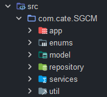
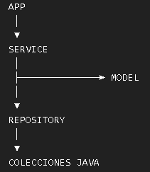
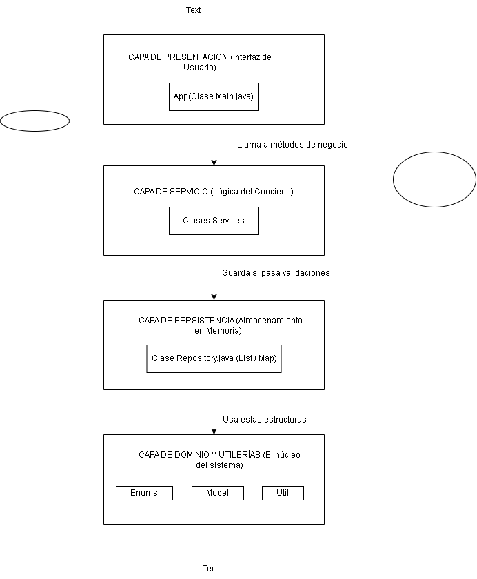
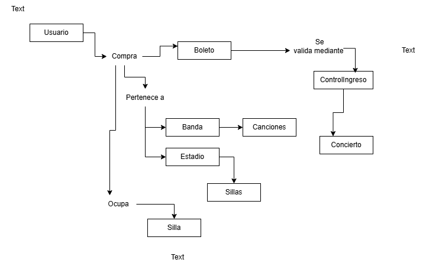
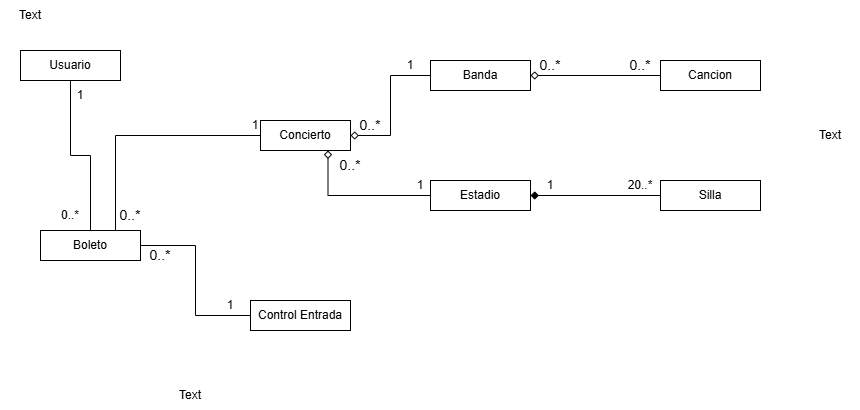
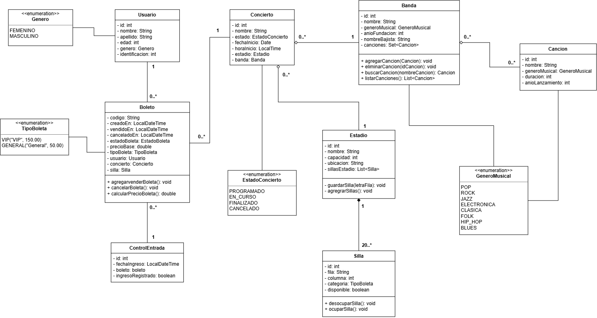

# DOCUMENTACIÓN TÉCNICA DEL SISTEMA

# CONCIERTO MASTER

Documento de Diseño Técnico

Versión: 1.0Autor: Caterine Salinas BolanosFecha: 17/11/2026

# Tabla de contenido

- Introducción1.1 Propósito del documento1.2 Objetivo del diseño técnico1.3 Relación con la Especificación de Requisitos del Sistema
- Arquitectura del sistema2.1 Arquitectura seleccionada2.2 Estructura del proyecto2.3 Responsabilidades de cada componente2.4 Flujo de comunicación entre componentes2.5 Diagrama de arquitectura
- Diseño del dominio3.1 Entidades principales3.2 Descripción de las entidades3.3 Relaciones entre entidades3.4 Reglas y responsabilidades del dominio3.5 Diagrama del dominio
- Diseño de clases4.1 Diagrama de clases UML4.2 Descripción de clases4.3 Atributos y responsabilidades4.4 Métodos principales4.5 Relaciones y cardinalidades
- Diseño de servicios5.1 Responsabilidad de la capa Service5.2 Servicios del sistema5.3 Responsabilidades de cada servicio5.4 Interacción entre servicios
- Diseño de repositorios6.1 Responsabilidad de Repository6.2 Repositorios del sistema6.3 Estructuras de almacenamiento6.4 Criterios de búsqueda y unicidad
- Diseño de Enums7.1 Estados del concierto7.2 Estados del boleto7.3 Estados de la silla
- Diseño de utilidades8.1 Responsabilidad de Util8.2 Identificadores8.3 Validaciones generales8.4 Otras utilidades reutilizables
- Gestión de datos en memoria9.1 Almacenamiento temporal9.2 Colecciones utilizadas9.3 Integridad de los datos
- Validaciones y aplicación de reglas de negocio10.1 Validaciones generales10.2 Validaciones de usuarios10.3 Validaciones de bandas y canciones10.4 Validaciones de estadios y sillas10.5 Validaciones de conciertos10.6 Validaciones de boletos10.7 Validaciones de ingreso
- Estructura de paquetes11.1 Organización del proyecto11.2 Dependencias entre componentes
- Flujos principales del sistema12.1 Registro de usuario12.2 Gestión de conciertos12.3 Compra de boleto12.4 Cancelación de boleto12.5 Control de ingreso
- Manejo de errores y excepciones13.1 Validaciones fallidas13.2 Mensajes al usuario13.3 Manejo de excepciones
- Tecnologías y herramientas14.1 Lenguaje de programación14.2 Herramientas de desarrollo14.3 Control de versiones14.4 Herramientas de diagramación
- Consideraciones técnicas15.1 Limitaciones de la implementación15.2 Gestión de pagos15.3 Autenticación y roles15.4 Consideraciones de mantenimiento15.5 Consideraciones de escalabilidad
- Anexos16.1 Diagrama de arquitectura16.2 Diagrama de dominio16.3 Diagrama de clases UML16.4 Otros diagramas técnicos

# 1. Introducción

## 1.1 Propósito del documento

El presente documento tiene como propósito definir el diseño técnico del sistema Concierto Master, estableciendo la estructura mediante la cual será desarrollado el proyecto.

La documentación describe la organización de los componentes del sistema, las responsabilidades de cada uno, las entidades que conforman el dominio, la gestión de la información en memoria, las estructuras de almacenamiento y los principales criterios técnicos que serán utilizados durante la implementación.

Este documento complementa la Especificación de Requisitos del Sistema (ERS), transformando las necesidades funcionales previamente definidas en una estructura técnica que permita orientar el desarrollo de la aplicación.

## 1.2 Objetivo del diseño técnico

Definir una estructura técnica organizada para el desarrollo de Concierto Master, separando las responsabilidades relacionadas con el dominio, la lógica de negocio, el almacenamiento temporal de información y las funcionalidades auxiliares.

El diseño busca facilitar la comprensión, mantenimiento y evolución del código, aplicando principios de programación orientada a objetos y una separación clara de responsabilidades.

## 1.3 Relación con la Especificación de Requisitos del Sistema

La presente documentación técnica se encuentra directamente relacionada con la Especificación de Requisitos del Sistema.

Mientras la ERS establece qué debe hacer el sistema y bajo qué reglas debe comportarse, esta documentación establece cómo se organizará técnicamente el software para implementar dichas funcionalidades.

Las reglas de negocio definidas en la ERS deberán ser consideradas durante el diseño de las entidades y de los servicios responsables de ejecutarlas.

# 2. Arquitectura del sistema

## 2.1 Arquitectura seleccionada

Concierto Master utiliza una estructura orientada al dominio, organizada mediante componentes que separan las entidades del sistema, la lógica de negocio, el acceso a la información almacenada en memoria y las funcionalidades auxiliares.

La estructura está compuesta por:

- app
- dto
- enums
- exception
- model
- repository
- services
- util
La información se almacena temporalmente en memoria mediante colecciones de Java, debido a que el proyecto no contempla el uso de una base de datos.

## 2.2 Estructura del proyecto

La estructura general propuesta será:

Las clases concretas que pertenecerán a cada paquete serán definidas durante el diseño detallado del sistema.

## 2.3 Responsabilidades de cada componente

### 2.3.1 App

Corresponde al punto de entrada de la aplicación.

Sus responsabilidades principales serán:

- Iniciar la ejecución del sistema.
- Gestionar la interacción inicial mediante consola.
- Presentar las opciones disponibles.
- Invocar las funcionalidades correspondientes.
La capa app no deberá contener reglas de negocio complejas.

### 2.3.2 Model

Contendrá las clases que representan los principales elementos del dominio.

Inicialmente se contemplan:

- Usuario
- Banda
- Cancion
- Estadio
- Silla
- Concierto
- Boleto
- ControlIngreso
Estas clases representarán la información y relaciones propias del sistema.

La clase Silla forma parte del modelo, pero su gestión dependerá directamente del Estadio, por lo que no tendrá una administración independiente mediante CRUD.

ControlIngreso representa el concepto relacionado con el registro y control del ingreso de los asistentes al concierto.

### 2.3.3 Service

Será responsable de implementar la lógica de negocio.

Sus responsabilidades principales serán:

- Ejecutar las operaciones solicitadas.
- Aplicar las reglas de negocio.
- Realizar validaciones.
- Coordinar diferentes entidades.
- Consultar y modificar información mediante los repositorios.
- Garantizar que las operaciones cumplan las condiciones establecidas.
Las reglas relacionadas con operaciones como compra de boletos, modificación de conciertos, eliminación de bandas o validación de ingreso deberán implementarse en esta capa.

### 2.3.4 Repository

Será responsable de administrar la información almacenada temporalmente en memoria.

Sus responsabilidades serán:

- Registrar entidades.
- Buscar entidades.
- Consultar información.
- Actualizar entidades.
- Eliminar entidades cuando corresponda.
- Administrar las colecciones utilizadas como almacenamiento.
Los repositorios no deberán contener reglas de negocio.

### 2.3.5 Enums

Contendrá los valores enumerados utilizados por el sistema.

Inicialmente se contemplan:

### EstadoConcierto

- PROGRAMADO
- EN_CURSO
- FINALIZADO
- CANCELADO

### EstadoBoleto

- ACTIVO
- CANCELADO

### GeneroPersona

- FEMENINO
- MASCULINO

### GeneroMusical

- POP
- ROCK
- JAZZ
- ELECTRONICA
- CLASICA
- FOLK
- HIP_HOP
- BLUES

### Categoria

- VIP
- GENERAL

El sistema maneja dos categorías de boleto: GENERAL y VIP. Cada una tiene un precio base definido por el concierto, con un mínimo de 30.000 COP y 60.000 COP respectivamente. El estadio asigna la categoría a cada silla y el boleto toma la de la silla seleccionada.

Los Enums permitirán restringir los valores válidos para los diferentes estados del sistema.

### 2.3.6 Util

Contendrá funcionalidades auxiliares y reutilizables que no pertenezcan directamente a una entidad ni representen reglas específicas del negocio.

Podrá utilizarse principalmente para:

- Generación o manejo de identificadores.
- Validaciones generales de datos de entrada.
- Procesamiento auxiliar de información.
- Funcionalidades reutilizables por diferentes componentes.
Util no deberá contener reglas de negocio.

## 2.4 Flujo de comunicación entre componentes

De manera general, las operaciones seguirán un flujo similar a:

Los Enums serán utilizados por las clases y servicios que necesiten representar estados controlados.

Util podrá ser utilizado por diferentes componentes cuando se requieran funcionalidades auxiliares.

## 2.5 Diagrama de arquitectura

# 3. Diseño del dominio

## 3.1 Entidades principales

El dominio de Concierto Master estará compuesto inicialmente por:

| Entidad | Responsabilidad |
|---|---|
| Usuario | Representar a una persona registrada en el sistema. |
| Banda | Representar una agrupación musical participante en conciertos. |
| Canción | Representar una canción que puede estar asociada a una banda. |
| Estadio | Representar el lugar donde se realiza un concierto. |
| Silla | Representar una ubicación dentro del estadio. |
| Concierto | Representar un evento musical. |
| Boleto | Representar el derecho de un usuario a ingresar a un concierto. |
| ControlIngreso | Representar el control y registro del ingreso de asistentes. |

## 3.2 Descripción de las entidades

### Usuario

Representa a una persona registrada dentro del sistema.

Puede:

- Registrarse.
- Consultar su información.
- Actualizar su información.
- Consultar conciertos.
- Comprar boletos.
- Cancelar boletos.
- Ingresar a un concierto mediante un boleto válido.

### Banda

Representa una agrupación musical.

Una banda puede tener canciones asociadas y puede participar en uno o varios conciertos.

Una banda asociada a un concierto no podrá eliminarse.

### Canción

Representa una canción que puede estar asociada a una banda.

Una canción puede existir independientemente de una banda.

Su eliminación estará condicionada por las relaciones existentes con conciertos.

### Estadio

Representa el lugar donde se realizará un concierto.

El estadio posee una capacidad determinada y genera sus sillas de acuerdo con dicha capacidad.

La capacidad exigida es mayor o igual a 20 y múltiplo de 10. El modelo la valida al registrar y al modificar el estadio.

La capacidad estará condicionada por la disponibilidad de las sillas. No podrá modificarse si existe una silla en estado OCUPADA.

### Silla

Representa una ubicación física dentro de un estadio.

Su disponibilidad se representa con el atributo booleano disponible.

Las sillas son generadas y administradas como parte del estadio y no tendrán operaciones CRUD independientes.

### Concierto

Representa el evento musical.

Debe estar asociado a:

- Una banda.
- Un estadio.
Su estado será gestionado automáticamente de acuerdo con la fecha y hora del evento.

### Boleto

Representa la autorización de un usuario para asistir a un concierto.

Está asociado a:

- Un usuario.
- Un concierto.
- Una silla.
Puede encontrarse en estado activo o cancelado.

### ControlIngreso

Representa el proceso mediante el cual se valida y registra el ingreso de un usuario al concierto.

Para registrar un ingreso se deberán verificar las condiciones definidas en las reglas de negocio.

## 3.3 Relaciones entre entidades

Las principales relaciones del dominio son:

Las relaciones y cardinalidades se detallan en §4.5; el modelo de clases, en §4.1.

## 3.4 Reglas y responsabilidades del dominio

Las entidades deberán respetar las reglas de negocio establecidas en la ERS.

Entre las principales condiciones se encuentran:

- Los usuarios deben poseer una identificación única.
- Una banda asociada a un concierto no podrá eliminarse.
- Una canción asociada a una banda que participe en un concierto no podrá eliminarse.
- Una banda deberá tener canciones asociadas para poder ser utilizada en la creación de un concierto.
- La equivalencia de canciones (RN-08A) se define una sola vez en `Cancion`: un método compara nombre (sin distinción de mayúsculas), año y género musical. `Banda` delega en ese método para decidir si agrega una canción a su repertorio.
- El recorrido del repertorio para detectar equivalentes se concentra en un único método privado de `Banda`, utilizado tanto al agregar como al actualizar. Así no se duplican ni el criterio ni el recorrido. El `id` es la identidad de la canción: no se definen `equals`/`hashCode` sobre campos editables, y `util` no participa porque solo contiene ayudas genéricas.
- Las sillas serán generadas automáticamente según la capacidad del estadio.
- La capacidad del estadio deberá ser mayor o igual a 20 y múltiplo de 10.
- La capacidad de un estadio solo podrá modificarse cuando todas sus sillas estén disponibles.
- Un concierto deberá estar asociado a una banda y un estadio previamente registrados.
- La banda asociada a un concierto deberá contener canciones.
- La información de un concierto no podrá modificarse cuando existan boletos activos.
- Solo podrán venderse boletos para conciertos en estado PROGRAMADO.
- Solo podrá registrarse el ingreso cuando el concierto esté EN_CURSO.
- Un boleto cancelado no permitirá el ingreso.
- Un boleto solo podrá utilizarse una vez.

## 3.5 Diagrama del dominio

Este diagrama deberá representar las entidades principales y las relaciones existentes entre ellas, sin entrar todavía en el detalle completo de atributos y métodos.

# 4. Diseño de clases

## 4.1 Diagrama de clases UML

## 4.2 Descripción de clases

Usuario

Representa a la persona que utiliza el sistema para consultar conciertos y adquirir boletos. Un usuario puede realizar compras para diferentes conciertos y tener asociados uno o varios boletos.

Concierto

Representa un evento musical que puede ser consultado y adquirido por los usuarios. Contiene la información propia del evento y se encuentra asociado a una banda y a un estadio donde se llevará a cabo.

Banda

Representa al grupo o artista musical que participa en un concierto. Una banda puede estar asociada a un conjunto de canciones que conforman su repertorio.

Canción

Representa una canción perteneciente al repertorio de una banda. Contiene la información necesaria para identificarla y describirla.

Estadio

Representa el lugar físico donde se realiza un concierto. Cuenta con una capacidad determinada y está compuesto por las sillas disponibles para el evento.

Silla

Representa una ubicación física dentro del estadio que puede ser asignada para la asistencia a un concierto. Puede pertenecer a una determinada zona o tipo de localidad.

Boleto

Representa la entrada adquirida por un usuario para asistir a un concierto. Permite identificar la compra y la ubicación asignada, y puede contener información relacionada con su estado.

Enums

Los enumerados representan conjuntos cerrados de valores utilizados para clasificar o controlar determinados atributos de las clases. Por ejemplo, pueden utilizarse para representar tipos de silla o estados de un boleto.

## 4.3 Atributos y responsabilidades

| Clase | Atributos principales | Responsabilidad |
|---|---|---|
| Usuario | Id, identificación, nombre, apellido, edad, género | Representar al usuario y mantener su información dentro del sistema. |
| Concierto | id, nombre, estado, precioGeneral, precioVip, fechaInicio, fechaFin, canceladoEn, estadio y banda | Representar el evento y mantener la información relacionada con su realización. |
| Banda | id, nombre, anioFundacion, nombreBajista y canciones (`List<Cancion>`) | Representar la banda participante y gestionar su repertorio. |
| Canción | id, nombre, generoMusical, duracion y anioLanzamiento | Representar una canción; el `id` es su identidad y el nombre es editable. |
| Estadio | Id, nombre, capacidad, ubicación y colección de sillas | Representar el lugar físico y administrar las sillas que lo conforman. |
| Silla | id, fila, columna, categoría y atributo booleano para validar la disponibilidad de la silla | Representar una ubicación física disponible dentro del estadio. |
| Boleto | codigo, creadoEn, canceladoEn, estadoBoleto, valor, usuario, concierto y silla | Representar la entrada adquirida y relacionar al usuario con el concierto y la ubicación asignada. |

## 4.4 Métodos principales

| Clase | Métodos principales |
|---|---|
| Usuario | Operaciones relacionadas con la gestión de la información propia del usuario. |
| Concierto | Operaciones relacionadas con la información y disponibilidad del evento. |
| Banda | agregarCancion(), buscarCancion() listarCancion() eliminarCancion(), un método privado de búsqueda de equivalentes compartido por agregar y actualizar, y operaciones relacionadas la información propia de la banda. |
| Canción | esEquivalenteA(nombre, anio, generoMusical) y operaciones relacionadas con la información propia de la canción. |
| Estadio | guardarSilla(), agregrarSillas(), y operaciones relacionadas con la información del estadio. |
| Silla | desocuparSilla(), ocuparSilla(), y operaciones relacionadas con su estado y disponibilidad. |
| Boleto | Operaciones relacionadas con la gestión de la información propia del boleto. |

## 4.5 Relaciones y cardinalidades

### Usuario — Boleto

Un usuario puede adquirir cero o varios boletos. Cada boleto está asociado a un usuario.

Cardinalidad:

Usuario 1 ───── 0..* Boleto

La relación se modela inicialmente como una asociación.

### Concierto — Boleto

Un concierto puede tener cero o muchos boletos asociados. Cada boleto corresponde a un concierto.

Cardinalidad:

Concierto 1 ───── 0..* Boleto

### Boleto — Silla

Un boleto puede estar asociado a una silla determinada para el concierto. Una silla puede estar libre o asociada a un boleto para un evento.

Cardinalidad conceptual:

Silla 1 ───── 0..1 Boleto

Esta relación deberá revisarse posteriormente si el sistema permite reutilizar una misma silla en diferentes conciertos.

### Concierto — Estadio

Un concierto se realiza en un estadio y un estadio puede albergar diferentes conciertos en distintos momentos.

Cardinalidad:

Estadio 1 ◇──────── 0..* Concierto

Se representa inicialmente como una agregación.

### Estadio — Silla

Un estadio está compuesto por un conjunto de sillas que representan sus ubicaciones físicas.

Cardinalidad:

Estadio 1 ◆──── 20..* Silla

La composición se utiliza si se establece que las sillas forman parte de la estructura del estadio y dependen de este para su ciclo de vida dentro del modelo.

### Banda — Canción

Una banda posee un repertorio compuesto por diferentes canciones.

Cardinalidad inicial:

- Banda 0..*───── 0..* Canción
El tipo exacto de relación deberá confirmarse según si una canción puede pertenecer a diferentes bandas dentro del dominio.

### Concierto — Banda

Un concierto cuenta con una banda o artista participante.

Cardinalidad inicial:

Concierto 0..* ───── 1 Banda

Esta cardinalidad deberá ajustarse si el sistema contempla conciertos con varias bandas o artistas.

### Clases — Enumeraciones

Las clases que utilizan un enum tendrán un atributo cuyo tipo corresponde a dicho enumerado. Por ejemplo:

Boleto.estado: EstadoBoleto

El enum se representa de forma independiente mediante el estereotipo «enumeration» y sus valores posibles.

# 5. Diseño de servicios

## 5.1 Responsabilidad de la capa Service

La capa Service concentrará las operaciones y reglas de negocio que requieran coordinación entre diferentes entidades.

## 5.2 Servicios del sistema

Inicialmente se contemplan:

- UsuarioService
- IngresoService
- CancionService
- TaquillaVentaService
La existencia definitiva de cada servicio será validada durante el diseño técnico detallado.

## 5.3 Responsabilidades de cada servicio

Pendiente de definir en conjunto.

Aquí estableceremos exactamente qué operaciones tendrá cada servicio y qué reglas de negocio deberá aplicar.

## 5.4 Interacción entre servicios

Pendiente de definir.

Se determinará qué servicios deberán comunicarse entre sí y cuándo una operación requerirá información de más de una entidad.

# 6. Diseño de repositorios

## 6.1 Responsabilidad de Repository

Los repositorios serán responsables del almacenamiento temporal de las entidades mediante colecciones de Java. Su función se limita a guardar, recuperar, listar y eliminar entidades.

Los repositorios no contienen reglas de negocio. Las validaciones, restricciones y decisiones sobre si una operación se permite o no son responsabilidad de la capa Service. El repositorio solo responde a las solicitudes de almacenamiento y búsqueda que el service le realiza.

## 6.2 Repositorios del sistema

No se establecerán repositorios para todas las clases del dominio. Su existencia se determina según las necesidades reales de almacenamiento.

Un único RepositorioGenerico<T, ID> sobre Map<ID, T> cubre el almacenamiento de todas las entidades. No hay repositorios por entidad; las sillas viven dentro de Estadio y no tienen CRUD propio.

## 6.3 Estructuras de almacenamiento

La selección de la estructura de almacenamiento de cada repositorio se realizará considerando:

- Cómo se recupera la información (por clave, recorriendo, o solo listando).
- Si el orden es relevante.
- Si el mismo objeto puede repetirse.
Criterios:

- List: para secuencias donde el orden sea relevante y la colección pueda admitir elementos equivalentes.
- Set: para colecciones donde los elementos deban mantenerse sin duplicados, de acuerdo con la definición de igualdad de los objetos.
- Map: para escenarios donde exista una relación clave → entidad y el acceso mediante dicha clave sea una necesidad relevante.
Nota: la clave del Map es el identificador pasado a guardar(id, entidad). Los campos de negocio se buscan filtrando los valores desde el servicio.

## 6.4 Selección de colecciones por repositorio

RepositorioGenerico<T, ID> usa un único Map<ID, T> indexado por el identificador. El acceso por clave es O(1) promedio; listarRegistros() devuelve una copia en ArrayList.

## 6.5 Operaciones comunes del repositorio

Los repositorios deberán ofrecer, como mínimo, las siguientes operaciones:

- guardar(id, entidad): almacena o reemplaza la entidad asociada a id.
- buscarRegistro(id): devuelve la entidad asociada al id, o null si no existe.
- listarRegistros(): devuelve una copia de todas las entidades almacenadas.
- eliminarRegistro(id): elimina la entidad asociada al id.
Los repositorios no aplican reglas de negocio. Solo almacenan y devuelven información. Las validaciones (unicidad de cédula, estado del concierto, disponibilidad de silla, etc.) son responsabilidad del Service.

## 6.6 Diseño genérico de repositorios

Se identifica un conjunto de operaciones comunes de almacenamiento que ya se implementa en RepositorioGenerico<T, ID> sobre Map<ID, T>, parametrizado por el tipo de entidad y el tipo de su identificador.

# 7. Diseño de Enums

## 7.1 Estado del concierto

El concierto manejará los siguientes estados:

PROGRAMADO

EN_CURSO

FINALIZADO

CANCELADO

El cambio de estado se realizará de acuerdo con las reglas definidas para el ciclo de vida del concierto.

## 7.2 Estado del boleto

ACTIVO

CANCELADO

## 7.3 Disponibilidad de la silla

El atributo booleano disponible indica si la silla está libre (true) u ocupada (false).

# 8. Diseño de utilidades

## 8.1 Responsabilidad de Util

El paquete util contendrá funcionalidades auxiliares de carácter general y reutilizable.

## 8.2 Identificadores

Pendiente de definir.

Se determinará cómo se generarán y gestionarán los identificadores de las entidades que los requieran.

## 8.3 Validaciones generales

Pendiente de definir.

Se determinará qué validaciones son suficientemente generales para ubicarse en Util y cuáles corresponden directamente a la lógica de negocio de los servicios.

## 8.4 Otras utilidades reutilizables

Pendiente de definir.

# 9. Gestión de datos en memoria

## 9.1 Características del almacenamiento

La aplicación utilizará almacenamiento temporal en memoria durante la ejecución. No se implementará persistencia en una base de datos dentro del alcance actual.

## 9.2 Persistencia de la información

La información almacenada se perderá al finalizar la ejecución de la aplicación.

## 9.3 Integridad de los datos

La aplicación deberá aplicar las validaciones necesarias para evitar inconsistencias en la información almacenada.

Las reglas de negocio serán responsabilidad de la capa Service.

# 10. Validaciones y aplicación de reglas de negocio

Las validaciones serán implementadas principalmente en la capa Service.

Deberán considerarse las reglas definidas en la documentación funcional para:

- Usuarios.
- Bandas.
- Canciones.
- Estadios.
- Conciertos.
- Boletos.
- Control de ingreso.
El diseño detallado de estas validaciones será realizado durante la construcción de cada servicio.

# 11. Estructura de paquetes

La estructura inicial será:

app

model

service

repository

enums

util

La estructura podrá ampliarse cuando el diseño técnico determine la necesidad de interfaces u otros componentes, sin incorporar elementos que no sean necesarios para el alcance actual.

# 12. Flujos principales del sistema

Los principales flujos que deberán considerarse durante la implementación son:

## 12.1 Registro de usuario

Registro → Validación → Almacenamiento → Usuario registrado.

## 12.2 Gestión de conciertos

Registro de banda y canciones → Registro de estadio → Creación del concierto → Estado PROGRAMADO → Inicio → EN_CURSO → Finalización → FINALIZADO.

## 12.3 Compra de boleto

Selección de concierto → Validación del estado → Selección de silla → Validación de disponibilidad → Registro del boleto → Silla OCUPADA.

## 12.4 Cancelación de boleto

Solicitud de cancelación → Validación del boleto → Estado CANCELADO → Silla DISPONIBLE.

## 12.5 Control de ingreso

Presentación del boleto → Validación del boleto → Validación del concierto → Verificación de uso previo → Registro del ingreso.

# 13. Manejo de errores y excepciones

## 13.1 Validaciones fallidas

Pendiente de definir.

## 13.2 Mensajes al usuario

Pendiente de definir.

## 13.3 Manejo de excepciones

Pendiente de definir.

# 14. Tecnologías y herramientas

## 14.1 Lenguaje de programación

El sistema será desarrollado utilizando Java y programación orientada a objetos.

## 14.2 Herramientas de desarrollo

Se contempla el uso de:

- IntelliJ IDEA.
- JDK.

## 14.3 Control de versiones

Se utilizará Git para el control de versiones del código fuente.

## 14.4 Herramientas de diagramación

Para la elaboración de diagramas UML y documentación técnica podrán utilizarse herramientas como:

- diagrams.net (draw.io).
- PlantUML.
- Herramientas UML compatibles con el entorno de desarrollo.

# 15. Consideraciones técnicas

## 15.1 Limitaciones de la implementación

El proyecto tendrá las siguientes limitaciones:

- No utilizará una base de datos.
- La información será almacenada únicamente en memoria.
- No tendrá interfaz gráfica.
- La interacción será mediante consola.
- No se implementará autenticación.
- No se implementarán roles técnicamente dentro del código.
- No se integrará una pasarela de pagos.
- No se integrarán servicios externos.
Los roles Administrador, Usuario y Personal de ingreso forman parte de la definición funcional del sistema, pero no se implementará un mecanismo formal de autenticación y autorización.

## 15.2 Gestión de pagos

La gestión de pagos no forma parte del alcance técnico.

El sistema asumirá que el proceso de pago fue realizado exitosamente antes de completar la emisión del boleto.

Por lo tanto, no se implementarán:

- Métodos de pago.
- Tarjetas.
- Transacciones bancarias.
- Pasarelas de pago.
- Estados de transacciones financieras.
Dentro del alcance actual, un boleto representa una compra que se considera completada.

## 15.3 Autenticación y roles

La autenticación y autorización no serán implementadas técnicamente.

Los actores definidos funcionalmente son:

- Administrador.
- Usuario.
- Personal de ingreso.
Estos actores se utilizan para definir las responsabilidades y funcionalidades del sistema, pero no se desarrollará un mecanismo de inicio de sesión ni control de permisos.

## 15.4 Consideraciones de mantenimiento

La separación de responsabilidades permitirá modificar una parte del sistema sin afectar directamente las demás.

Por ejemplo, una futura migración desde almacenamiento en memoria hacia una base de datos podría concentrar gran parte de los cambios en la implementación de los repositorios.

## 15.5 Consideraciones de escalabilidad

La implementación actual está orientada al aprendizaje y a la práctica de diseño y desarrollo de software.

El almacenamiento mediante colecciones en memoria no está diseñado para soportar grandes volúmenes de información ni múltiples usuarios concurrentes.

Una versión futura podría incorporar:

- Base de datos.
- Persistencia.
- API.
- Autenticación.
- Autorización.
- Pasarela de pagos.
- Interfaz gráfica.
Estos elementos se encuentran fuera del alcance actual.

# 16. Anexos

## 16.1 Diagrama de arquitectura

## 16.2 Diagrama de dominio

## 16.3 Diagrama de clases UML

## 16.4 Otros diagramas técnicos

